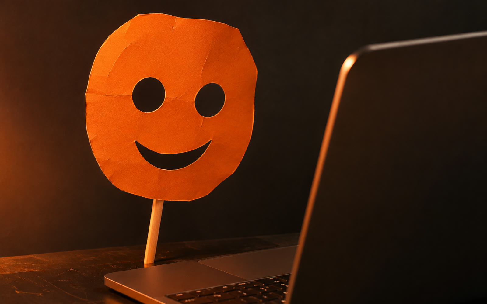

<p align="center"></p>

# Facecam

Put any face on your webcam, live, in Discord. Drop a photo into the window, press Start, and pick **OBS Virtual Camera** as your camera in Discord. Works on Mac and Windows.

**Website and downloads: [austnnnnnn.github.io/facecam](https://austnnnnnn.github.io/facecam/)**



It's a small app around [Deep-Live-Cam](https://github.com/hacksider/Deep-Live-Cam). The face swap runs on your own computer: the Neural Engine on a Mac, the graphics card on Windows (NVIDIA, AMD and Intel all work).

## Mac

Needs a Mac with Apple silicon (M1 or newer) on macOS 14 or later.

The easiest way is one line in Terminal, which skips the "unverified developer" warning:

```sh
curl -fsSL https://raw.githubusercontent.com/AUstnnnnnn/facecam/main/mac/install.sh | sh
```

Or download **[Facecam.dmg](https://github.com/AUstnnnnnn/facecam/releases/download/mac/Facecam.dmg)**, drag Facecam into Applications and open it. macOS will say it can't check the app. Click **Done**, then go to **System Settings → Privacy & Security** and click **Open Anyway**.

The first time it opens, Facecam walks you through three steps: installing the face engine (about 1.5 GB, including OBS), allowing the camera, and turning on OBS's virtual camera. macOS asks you to allow that camera extension once, and the app tells you where.

To remove it, drag Facecam to the Trash and delete `~/Library/Application Support/Facecam`.

## Windows

1. Download **[Facecam-Setup.exe](https://github.com/AUstnnnnnn/facecam/releases/download/setup/Facecam-Setup.exe)** and run it.
2. Windows may say "Windows protected your PC" because the installer isn't signed. Click **More info**, then **Run anyway**.
3. The installer sets up Python, the face swap engine, the face models and OBS Studio. The first install downloads about 1.5 GB, so give it a few minutes. If OBS asks for permission to install, say yes.

No admin rights needed. To update, run a newer Facecam-Setup.exe: it skips anything that's already installed. To remove Facecam, use **Settings → Apps**. That also deletes your saved photos and presets.

## Using it

1. Open Facecam.
2. Drag a face photo into the window. You can drag it straight from your browser, or click the box to pick a file. A clear photo of someone looking at the camera works best. Drop 3 to 5 photos of the same person (different angles and lighting) and they get blended for a closer match. **Clear** starts over with someone new.
3. Pick your webcam. The virtual camera shows you as you are until you press **Start**, then their face scans onto yours. **Stop** scans it back off.
4. In Discord, go to **User Settings → Voice & Video → Camera** and choose **OBS Virtual Camera**.

Start Facecam before you turn your camera on in Discord. Only one app can use the webcam at a time, and Facecam has to be the one holding it.

To keep a face for later, open **Presets** and save the photos as a preset. Pick it from the same menu next time, even mid-call.

## If something goes wrong

- **"Camera didn't open":** another app has the webcam, usually Discord. Quit it fully (it keeps running in the menu bar or system tray), press Start in Facecam, then set Discord's camera to OBS Virtual Camera. After that both can stay open.
- **"OBS Virtual Camera isn't set up yet":** on a Mac, click **Set Up**, then switch on OBS in **System Settings → General → Login Items & Extensions → Camera Extensions**. On Windows, open OBS once, click **Start Virtual Camera**, close OBS and press Start again.
- **It's slow or choppy:** add some light in front of you. A darker room makes face tracking work harder. Slower computers top out around 10 to 15 frames per second.
- **Anything else:** send the log over. Mac: `~/Library/Logs/Facecam.log` and `Facecam-setup.log`. Windows: `facecam.log` and `install.log` in `%LOCALAPPDATA%\Programs\Facecam`.

## What's in here

| | |
|---|---|
| `facecam.py`, `install.bat`, `installer/` | Windows app (PySide6) and its Inno Setup installer |
| `mac/` | Mac app (SwiftUI), `setup.sh` for first-run install, `build.sh` builds `dist/Facecam.app` and `Facecam.dmg` |
| `docs/` | The website (GitHub Pages) |
| `.github/workflows/build.yml` | Builds both installers, installs them on clean runners, runs the tests and publishes the releases |

## Notes

Ask people before you wear their face, and don't use this to pass yourself off as someone else. The face swap model (InsightFace inswapper) is licensed for non-commercial use only.

Licensed AGPL-3.0, same as Deep-Live-Cam.
